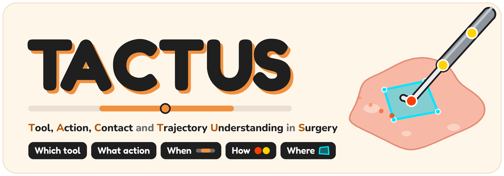
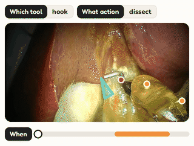
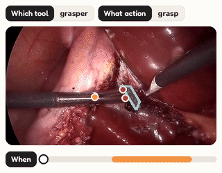
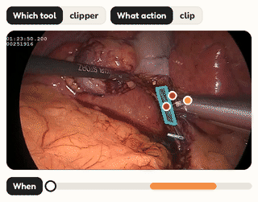
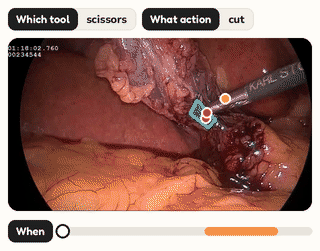
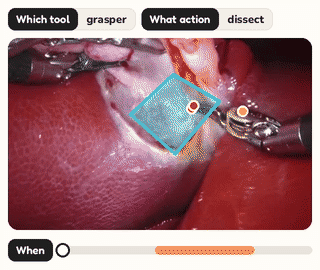
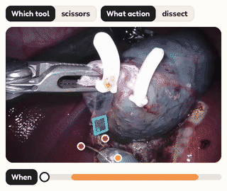

<p align="center"></p>

# TACTUS: Unifying Surgical Action Understanding in Time and Space

**TACTUS** (Tool, Action, Contact and Trajectory Understanding in Surgery) is a dataset and benchmark for following an instrument–tissue interaction from approach through completion. Each clip identifies the tool and action and marks the time windows. Nearly all clips also include per-frame spatial annotations of instrument motion and tissue involvement.

**[arXiv Paper](https://arxiv.org/html/2611.31956)** · **[Project Page](https://ruifreddie.github.io/TACTUS/)** · **[Dataset on Hugging Face](https://huggingface.co/datasets/hding2455/surgical-action-affordance)** · **[Checkpoints](https://huggingface.co/abccbd/TACTUS-TactusNet)** · **[Annotation guide](data/README.md)** · **[TactusNet](models/README.md)** · **[Evaluation protocol](evaluation/README.md)**

<table>
  <tr>
    <td></td>
    <td></td>
    <td></td>
  </tr>
  <tr>
    <td></td>
    <td></td>
    <td></td>
  </tr>
</table>

<p align="center"><sub>One Gold clip per tool–action pair, drawn from its annotation. 🔴 instrument tips · 🟡 instrument anchors · 🟦 contact region on the tissue · 🟧 interaction window inside the action window.</sub></p>

## Dataset

TACTUS contains **22,995 action clips** spanning approximately **2.9 million frames** from **141 videos**. It covers six tool–action pairs across five sources: Cholec80, HeiChole, CRCD, SurgVU, and a YouTube cholecystectomy collection.

| Tier | Clips | Videos | How the annotations are constructed |
| --- | ---: | ---: | --- |
| Gold | 15,668 | 101 | Human annotators label the tool, action, and time windows and place spatial prompts. Point tracking is followed by review and a final re-check. |
| Silver | 7,327 | 40 | Human annotators label the tool, action, and time windows. A model places spatial prompts for tracking on additional SurgVU clips. |

## What a clip describes

| Question | Annotation |
| --- | --- |
| **Which instrument acts?** | One of four tools: hook, grasper, scissors, or clipper. |
| **What does it do?** | One of four actions: dissect, grasp, clip, or cut. |
| **When does the interaction occur?** | An interaction window inside the full action window, which also includes approach and completion. |
| **How does the instrument move?** | Three instrument-specific landmarks tracked across the action window, with per-frame visibility. |
| **Where does it act on tissue?** | Four tissue-point tracks enclosing the affected region, also with per-frame visibility. |

For example, a grasper–grasp clip captures the approach, jaw closure, and retraction. The interaction window starts when the jaws begin to close and ends when the instrument stops moving after retraction. The tool landmarks describe the motion of the jaws, while the tissue points follow the region being grasped.

## Benchmark results

Table 3 compares TactusNet with 13 published baselines on 1,523 Gold test clips from 11 held-out videos. With per-head encoder fine-tuning, TactusNet reaches 95.8% tool–action pair accuracy and 18.68 px tool-point error at 384 × 384. ActionFormer achieves the highest temporal recall (46.6% at tIoU ≥ 0.7), and SegFormer achieves the highest Dice against human-annotated tissue regions (0.351).

Table 4(c) compares training data using the default frozen-encoder TactusNet. Adding Silver to Gold training raises pair accuracy from 93.8% to 95.5% on the same Gold test set. See the [evaluation protocol](evaluation/README.md) for the split, metric definitions, and scoring commands.

## Code release

This repository holds the code behind the benchmark: the evaluation protocol, TactusNet, the adapted baselines, and the tools to swap or fine-tune the encoder.

| I want to… | Start here |
| --- | --- |
| Score my own method on TACTUS | [`evaluation/`](evaluation/README.md): one prediction file per method, one scoring command. |
| Add a baseline | [`baselines/`](baselines/README.md): the data reader, the prediction format, and thirteen published methods already adapted. |
| Swap TactusNet's backbone | [`baselines/ablate/`](baselines/ablate/README.md): a registry of frozen encoders and the steps to add your own. |
| Fine-tune the encoder | [`baselines/ft/`](baselines/ft/README.md): one shared encoder, one encoder per head, and a frozen control. |
| Train TactusNet | [`training/`](training/README.md): the pipeline from the Hugging Face release to trained heads and test scores. |
| Train the contact decoder on either target | [`training/CONTACT_SUPERVISION.md`](training/CONTACT_SUPERVISION.md): hindsight targets (the default) or human-annotated regions. |
| Read the architecture | [`tactusnet/`](tactusnet/README.md): the heads and how they connect, with CPU tests. |

### Layout

| Directory | Contents |
| --- | --- |
| `data/` | How to read the annotations, and where the benchmark split lives. |
| `evaluation/` | The evaluation protocol and how to run the metric code. |
| `models/` | TactusNet in brief, with pointers to its code. |
| `tactusnet/` | Architecture and inference package. |
| `training/` | Training pipeline of TactusNet: clip export, token caching, the recipe of every head, evaluation. |
| `baselines/` | Shared data reader and metrics (`common/`), baselines for classification (`cls/`), temporal localization (`when/`), keypoints (`kpt/`) and contact regions (`where/`), the backbone swap (`ablate/`), and encoder fine-tuning (`ft/`). |

### Setup

```bash
git clone https://github.com/Ruifreddie/TACTUS.git && cd TACTUS
pip install -r training/pipeline/requirements.txt   # plus PyTorch with CUDA for your machine
export PYTHONPATH=$PWD
```

Each baseline family lists its few extra packages in its own `requirements.txt`. TactusNet and the temporal baselines read features of the V-JEPA 2.1 ViT-L encoder at 384 × 384; download `vjepa2_1_vitl_dist_vitG_384.pt` from the official [V-JEPA 2 release](https://github.com/facebookresearch/vjepa2) and point `VJEPA_CKPT` at it.

The training code is the code that produced the reported results, kept as it ran. Its scripts expect two directories: persistent storage (`GV`) and a fast local disk (`WORK`). [`training/README.md`](training/README.md) explains both.

### License

Code written for TACTUS is released under the [MIT License](LICENSE). Third-party code keeps its own license, listed in [`THIRD_PARTY.md`](THIRD_PARTY.md). The dataset and the source videos have their own terms; see [`data/README.md`](data/README.md).

## Authors

Lurui Wang¹*, Hao Ding¹*, Chenhao Yu², Chenyan Jing¹, Jiru Xu¹, Ruoqi Zuo¹, Liwei Mei¹, Chang Liu³, Lalithkumar Seenivasan¹, and Mathias Unberath¹†

¹ Johns Hopkins University · ² University of Virginia, Charlottesville · ³ University of Toronto

\* Equal contribution: [Lurui Wang](mailto:lwang255@jhu.edu) and [Hao Ding](mailto:hding2455@gmail.com).  
† Corresponding author: [Mathias Unberath](mailto:mathias@jhu.edu).

## Citation

```bibtex
@article{wang2026tactus,
  title   = {{TACTUS}: Unifying Surgical Action Understanding in Time and Space},
  author  = {Wang, Lurui and Ding, Hao and Yu, Chenhao and Jing, Chenyan and Xu, Jiru and Zuo, Ruoqi and Mei, Liwei and Liu, Chang and Seenivasan, Lalithkumar and Unberath, Mathias},
  journal = {arXiv preprint arXiv:2611.31956},
  year    = {2026},
  doi     = {10.48550/arXiv.2611.31956},
  url     = {https://arxiv.org/abs/2611.31956}
}
```
